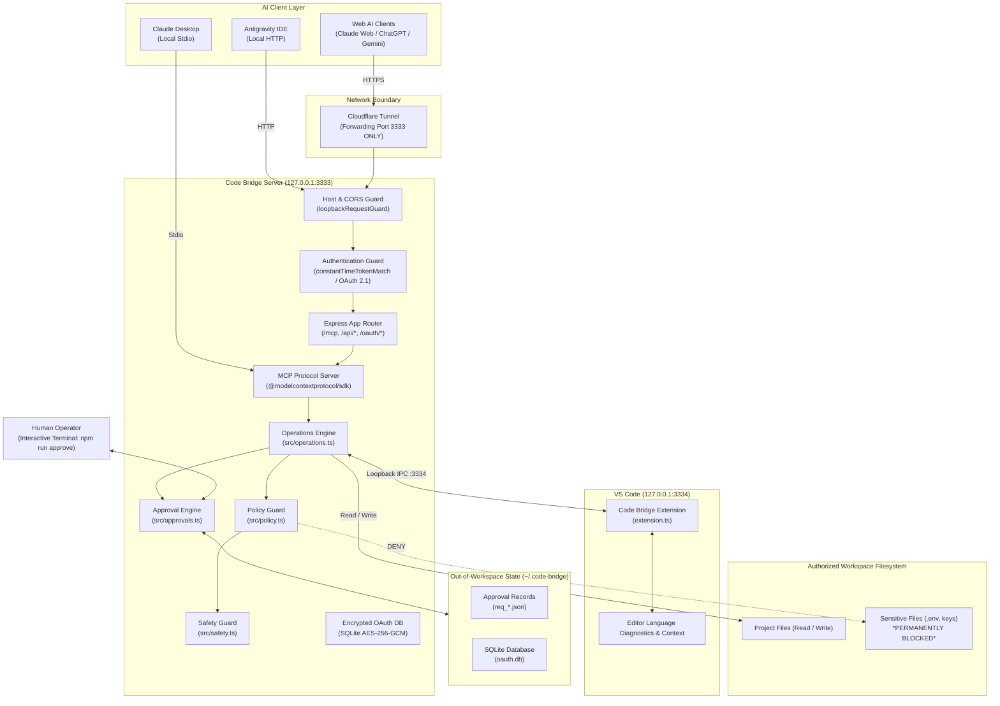
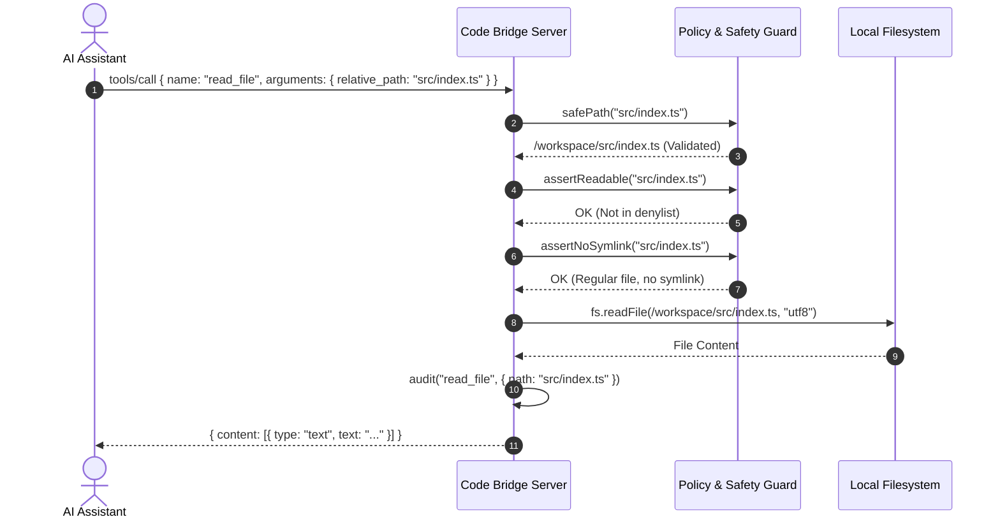
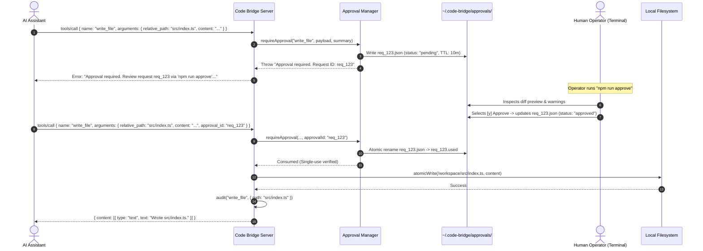

# Code Bridge MCP — Architecture Documentation

This document describes the internal architecture, security invariants, protocol handling, and component communication flows of Code Bridge MCP.

---

## 1. System Overview & Component Diagram

Code Bridge is designed around a decoupled, approval-first, zero-implicit-trust architecture:

---

## 2. Core Components & Responsibilities

### 2.1 Server Engine (`src/server.ts`)
- Manages HTTP listeners and binds strictly to `127.0.0.1`.
- Enforces DNS rebinding protection and Host header validation via `loopbackRequestGuard`.
- Configures CORS for trusted web AI origins (`chatgpt.com`, `claude.ai`, `gemini.google.com`, `aistudio.google.com`).
- Enforces body size limits (1MB maximum) and content-type parsing.
- Mounts MCP Streamable HTTP transport, REST API router, and OAuth 2.1 discovery metadata.

### 2.2 MCP Protocol Engine (`src/mcp-server.ts`)
- Built using the official Model Context Protocol TypeScript SDK (`@modelcontextprotocol/sdk`).
- Declares the 8 core tools (`list_files`, `read_file`, `search_code`, `write_file`, `delete_file`, `run_project_command`, `editor_context`, `editor_diagnostics`).
- Validates all tool input arguments with Zod schemas.

### 2.3 Operations Engine (`src/operations.ts`)
- Implements filesystem reading, listing, and searching.
- Manages atomic file writing (`atomicWrite`) via temporary staging files and atomic rename.
- Sanitizes child process environments and executes allowlisted npm commands via `child_process.execFile`.

### 2.4 Policy & Safety Guards (`src/policy.ts` & `src/safety.ts`)
- **`src/policy.ts`**: Pure functions classifying paths into allowed vs denied. Denies hidden credential folders (`.git`, `.ssh`, `.aws`, `.code-bridge`), secret files (`.env*`, `.npmrc`, `.pypirc`, `id_*`), and private keys (`*.pem`, `*.key`).
- **`src/safety.ts`**: Verifies path containment (`safePath`), rejects null bytes, Windows drive letters, and UNC paths, and recursively inspects path components for symlinks or NTFS junctions (`assertNoSymlink`). Provides constant-time token comparison (`constantTimeTokenMatch`).

### 2.5 Approval Engine (`src/approvals.ts` & `src/approve-cli.ts`)
- Manages human-in-the-loop authorization for all mutating actions (`write_file`, `delete_file`, `run_project_command`).
- Stores pending requests outside the workspace in `~/.code-bridge/approvals/`.
- Computes canonical SHA-256 hashes of call payloads.
- Enforces a 10-minute TTL and single-use atomic consumption using filesystem locks (`flag: "wx"`).
- Permanently rejects automatic approval (`CODE_BRIDGE_AUTO_APPROVE_WRITES=false`).

### 2.6 Dynamic Workspace Manager (`src/workspace-manager.ts`)
- Tracks the active workspace directory and multi-root folders reported by VS Code.
- Fails closed if all workspace folders are closed.
- Canonicalizes all paths with `fs.realpathSync`.

### 2.7 VS Code Extension (`vscode-extension/src/extension.ts`)
- Runs as an independent process inside VS Code.
- Listens exclusively on `127.0.0.1:3334`.
- Authenticates incoming requests from the local server using `x-code-bridge-token`.
- Extracts active document path, selection text, and language server diagnostics.

### 2.8 OAuth 2.1 Persistence (`src/oauth-store.ts` & `src/oauth.ts`)
- Implements RFC 8414, RFC 9728, RFC 7591, and RFC 7636.
- Uses `node:sqlite` in WAL mode with record-level AES-256-GCM encryption.
- Protects consent form submissions with sliding-window rate limiting.

---

## 3. Communication & Sequence Flows

### 3.1 File Read Flow

### 3.2 Approval-Gated Mutation Flow (Write / Delete / Command)

---

## 4. Security Invariants Summary

| Security Invariant | Implementation Mechanism | Enforcement Point |
|:---|:---|:---|
| **Human in the Loop** | Single-use cryptographic approval nonces (`req_...`) expiring in 10 minutes. | `src/approvals.ts` |
| **Zero Auto-Approval** | Any truthy `CODE_BRIDGE_AUTO_APPROVE_WRITES` causes an immediate startup crash. | `src/config-rules.ts` |
| **Workspace Isolation** | Canonical path resolution, symlink checking, and NTFS junction blocking. | `src/safety.ts` |
| **Secret Redaction** | Denylist blocking access to `.env`, private keys, SSH keys, credentials. | `src/policy.ts` |
| **Command Allowlist** | Fixed allowlist (`npm test`, `npm run build`, `npm run lint`, `npm run typecheck`) via `execFile`. | `src/operations.ts` |
| **Environment Scrubbing**| Child processes only receive allowlisted execution variables; secrets stripped. | `src/operations.ts` |
| **Loopback Binding** | Server and extension listen exclusively on `127.0.0.1`. Port 3334 never forwarded. | `src/server.ts`, `extension.ts` |

